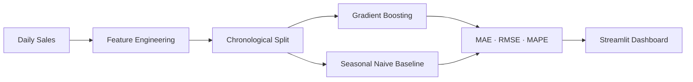

# Pharma Demand Forecasting

   [](https://github.com/raj75114043-design/ai-ml-portfolio/actions/workflows/ci.yml) [](https://raj-demand-forecasting-ml.streamlit.app) [](https://github.com/users/raj75114043-design/packages/container/package/ai-ml-portfolio%2Fdemand-forecasting-ml)

Daily demand forecasting for pharmaceutical products using gradient boosting with lag, rolling and
calendar features, evaluated with a strict **chronological split** against a **seasonal-naive baseline**.

## Business Problem

Inaccurate demand forecasts cause stock-outs of essential medicines or excess inventory that expires.
Planning teams need forecasts that beat simple rules of thumb and explain what drives demand.

## Approach

| Step | Implementation |
|---|---|
| Data | Three years of daily sales for three products with trend, weekly and yearly seasonality, promotions and holidays (synthetic) |
| Features | Lags 1/7/14/28, shifted rolling mean and standard deviation, day of week, month, day of year, promotion and holiday flags, last-week promotion and holiday flags |
| Leakage control | All rolling windows shifted by one day; chronological train/test split |
| Baseline | Seasonal naive — same day last week |
| Detrending | Target and level features scaled by the trailing 28-day mean, so the model follows growth trends |
| Model | HistGradientBoostingRegressor |
| Metrics | MAE, RMSE, MAPE; permutation feature importance |



## Results

Output of the reproducible run (`python main.py`):

```
Paracetamol 500mg  (MAE improvement vs baseline: 45%)
                              MAE    RMSE  MAPE %
Seasonal naive (last week)  65.53  102.41   10.53
Gradient boosting           36.11   58.62    6.35
Top drivers: day_of_week, promotion, month 

Vitamin D3 Tablets  (MAE improvement vs baseline: 43%)
                              MAE   RMSE  MAPE %
Seasonal naive (last week)  42.99  62.01   13.79
Gradient boosting           24.50  35.19    8.63
Top drivers: promotion, day_of_week, lag_1 

Cough Syrup 100ml  (MAE improvement vs baseline: 43%)
                              MAE   RMSE  MAPE %
Seasonal naive (last week)  49.02  74.70   13.04
Gradient boosting           27.74  42.91    8.00
Top drivers: promotion, day_of_week, day_of_year
```

## Run, Deploy and Test

**Web application**

```bash
cd demand-forecasting-ml
pip install -r requirements.txt
streamlit run app.py
```

Live demo: https://raj-demand-forecasting-ml.streamlit.app

**Docker**

```bash
docker build -t demand-forecasting-ml .
docker run -p 8501:8501 demand-forecasting-ml
# or pull the published image
docker pull ghcr.io/raj75114043-design/ai-ml-portfolio/demand-forecasting-ml:latest
```

**Tests**

```bash
pytest -q
```

Every push to the [`ai-ml-portfolio`](https://github.com/raj75114043-design/ai-ml-portfolio) repository runs this project's tests through GitHub Actions and publishes its Docker image to GitHub Container Registry.

> All sales data in this repository is synthetic.
