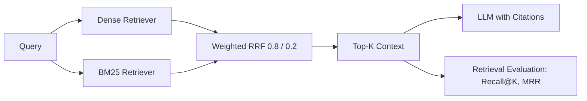

# Enterprise Hybrid RAG

    [](https://github.com/raj75114043-design/ai-ml-portfolio/actions/workflows/ci.yml) [](https://raj-enterprise-hybrid-rag.streamlit.app) [](https://github.com/users/raj75114043-design/packages/container/package/ai-ml-portfolio%2Fenterprise-hybrid-rag)

A retrieval-augmented generation pipeline for technical-support knowledge that combines
**dense semantic search** with **BM25 keyword search** through weighted Reciprocal Rank Fusion,
and measures retrieval quality separately from generation quality.

## Why Hybrid Retrieval

| Retriever | Strength | Weakness |
|---|---|---|
| Dense (embeddings) | Paraphrases and synonyms | Exact codes such as `E401` |
| Sparse (BM25) | Error codes, IDs, acronyms | Vocabulary mismatch |
| **Hybrid (RRF)** | Combines both | — |

## Architecture



## Production Configuration (reference)

| Component | Setting |
|---|---|
| Vector store | Pinecone, 1536-dimension embeddings |
| Chunking | 512 tokens, 100-token overlap |
| Fusion | 80% dense, 20% sparse |
| Evaluation | Recall@K, MRR, NDCG; RAGAS faithfulness target above 0.8 |

## Quick Start

```bash
pip install -r requirements.txt
python main.py
```

Install `sentence-transformers` to use real embeddings; without it the demo uses an offline
character n-gram fallback so it runs anywhere.

## Debugging Principle

When an answer is wrong, check retrieval first. If the correct evidence was retrieved, the issue
lies in context construction, prompting or generation — not in the retriever.

> All knowledge-base articles in this repository are synthetic.

## Web Application

Streamlit interface with an adjustable dense/sparse weight, Top-K control, grounded answers with citations, side-by-side rankings from each retriever and a live evaluation table. Set `ANTHROPIC_API_KEY` to generate answers with Claude; without it the app produces extractive, fully cited answers.

## Run, Deploy and Test

**Web application**

```bash
cd enterprise-hybrid-rag
pip install -r requirements.txt
streamlit run app.py
```

Live demo: https://raj-enterprise-hybrid-rag.streamlit.app

**Docker**

```bash
docker build -t enterprise-hybrid-rag .
docker run -p 8501:8501 enterprise-hybrid-rag
# or pull the published image
docker pull ghcr.io/raj75114043-design/ai-ml-portfolio/enterprise-hybrid-rag:latest
```

**Tests**

```bash
pytest -q
```

Every push to the [`ai-ml-portfolio`](https://github.com/raj75114043-design/ai-ml-portfolio) repository runs this project's tests through GitHub Actions and publishes its Docker image to GitHub Container Registry.
