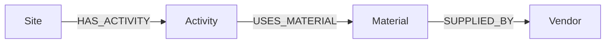

# Knowledge Graph Builder

    [](https://github.com/raj75114043-design/ai-ml-portfolio/actions/workflows/ci.yml) [](https://raj-knowledge-graph-builder.streamlit.app) [](https://github.com/users/raj75114043-design/packages/container/package/ai-ml-portfolio%2Fknowledge-graph-builder)

An end-to-end pipeline that turns tabular operational data into a validated knowledge graph,
with **ontology design**, **fuzzy entity resolution**, **schema validation** and **idempotent
Cypher export** for Neo4j.

## Ontology



## Pipeline

| Step | Implementation |
|---|---|
| Ingest | CSV sources for vendors, materials and activities |
| Entity resolution | Name normalisation + RapidFuzz token-sort matching; low-confidence matches go to manual review |
| Validation | Every edge checked against the ontology |
| Export | `MERGE` statements so reloads never create duplicates |
| Query | Multi-hop traversal Site → Activity → Material → Vendor |

Example: `"BETA POWER SYSTEMS LTD"` and `"Alpha Infra Suppliers"` are resolved to the correct
master vendors despite casing, suffix and spelling differences.

## Quick Start

```bash
pip install -r requirements.txt
python main.py
```

## When to Use a Graph vs SQL vs RAG

| Need | Best fit |
|---|---|
| Filtering and aggregation | Relational database |
| Multi-hop relationship traversal | Knowledge graph |
| Answers from unstructured documents | RAG |

> All data in this repository is synthetic.

## Web Application

Streamlit interface that renders the graph, runs multi-hop queries per site, shows every entity-resolution decision with its confidence, and exports a Neo4j Cypher load script.

## Run, Deploy and Test

**Web application**

```bash
cd knowledge-graph-builder
pip install -r requirements.txt
streamlit run app.py
```

Live demo: https://raj-knowledge-graph-builder.streamlit.app

**Docker**

```bash
docker build -t knowledge-graph-builder .
docker run -p 8501:8501 knowledge-graph-builder
# or pull the published image
docker pull ghcr.io/raj75114043-design/ai-ml-portfolio/knowledge-graph-builder:latest
```

**Tests**

```bash
pytest -q
```

Every push to the [`ai-ml-portfolio`](https://github.com/raj75114043-design/ai-ml-portfolio) repository runs this project's tests through GitHub Actions and publishes its Docker image to GitHub Container Registry.
