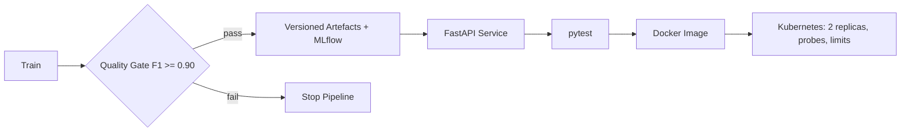

# MLOps Pipeline Template

      [](https://github.com/raj75114043-design/ai-ml-portfolio/actions/workflows/ci.yml) [](https://github.com/users/raj75114043-design/packages/container/package/ai-ml-portfolio%2Fmlops-pipeline-template)

A production-style template covering the full model lifecycle: **training with a quality gate,
experiment tracking, artefact versioning, a validated REST API, automated tests, containerisation,
CI and Kubernetes deployment**.

## Pipeline



## Components

| Stage | Implementation |
|---|---|
| Training | Random Forest with fixed seed and stratified split |
| Quality gate | Pipeline fails if F1 is below threshold |
| Tracking | MLflow parameters, metrics and artefacts (optional) |
| Serving | FastAPI with schema validation and `/health` endpoint |
| Testing | pytest for health, prediction and input validation |
| CI | GitHub Actions: train → test → build |
| Deployment | Kubernetes Deployment and Service with readiness/liveness probes |

## Quick Start

```bash
pip install -r requirements.txt
python -m src.train
pytest -q
uvicorn src.serve:app --reload        # http://localhost:8000/docs
```

### Docker

```bash
docker build -t mlops-pipeline-template .
docker run -p 8000:8000 mlops-pipeline-template
```

## Run, Deploy and Test

**Docker**

```bash
docker build -t mlops-pipeline-template .
docker run -p 8000:8000 mlops-pipeline-template
# or pull the published image
docker pull ghcr.io/raj75114043-design/ai-ml-portfolio/mlops-pipeline-template:latest
```

**Tests**

```bash
pytest -q
```

Every push to the [`ai-ml-portfolio`](https://github.com/raj75114043-design/ai-ml-portfolio) repository runs this project's tests through GitHub Actions and publishes its Docker image to GitHub Container Registry.
