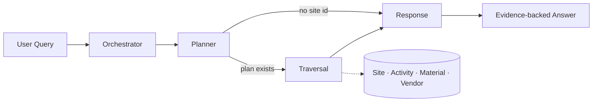

# Multi-Agent Root-Cause Analysis with LangGraph

   [](https://github.com/raj75114043-design/ai-ml-portfolio/actions/workflows/ci.yml) [](https://raj-multi-agent-rca-langgraph.streamlit.app) [](https://github.com/users/raj75114043-design/packages/container/package/ai-ml-portfolio%2Fmulti-agent-rca-langgraph)

A multi-agent workflow that answers operational questions such as *"Why is SITE-101 down?"* by traversing
site → activity → material → vendor relationships and returning an evidence-backed root cause.

## Why Multi-Agent

A single agent mixes routing, planning, tool execution and answer generation. Separating these
responsibilities makes each step easier to control, evaluate and debug.

| Agent | Responsibility |
|---|---|
| **Orchestrator** | Detects intent and extracts the site identifier |
| **Planner** | Decides which relationships must be traversed |
| **Traversal** | Calls read-only tools and collects structured evidence |
| **Response** | Builds the final answer strictly from collected evidence |

## Architecture



## Reliability Controls

- Shared, typed state (`RCAState`) instead of free-form agent conversation
- Explicit graph transitions and an iteration cap to prevent infinite loops
- Read-only tools with input validation; designed to sit behind MCP servers in production
- Deterministic agents, so every node can be unit-tested and later replaced with an LLM call

## Quick Start

```bash
pip install -r requirements.txt
python main.py
python main.py "Why is SITE-103 delayed?"
```

## Sample Output

```
Q: Why is SITE-101 down?
A: SITE-101 is DOWN. Root cause: 'Tower installation' is DELAYED because 'Steel tower kit'
   from Alpha Infra Supplies is late 14 days (3 open escalations).
```

## Project Structure

```
data/network.json   Synthetic site, activity, material and vendor data
src/state.py        Shared graph state
src/tools.py        Read-only data-access tools
src/agents.py       Orchestrator, Planner, Traversal and Response agents
src/graph.py        LangGraph wiring
main.py             Command-line entry point
```

> All data in this repository is synthetic and created for demonstration purposes.

## Web Application

Interactive Streamlit interface with sample questions, the live agent trace and a table of every piece of evidence the agents collected.

## Run, Deploy and Test

**Web application**

```bash
cd multi-agent-rca-langgraph
pip install -r requirements.txt
streamlit run app.py
```

Live demo: https://raj-multi-agent-rca-langgraph.streamlit.app

**Docker**

```bash
docker build -t multi-agent-rca-langgraph .
docker run -p 8501:8501 multi-agent-rca-langgraph
# or pull the published image
docker pull ghcr.io/raj75114043-design/ai-ml-portfolio/multi-agent-rca-langgraph:latest
```

**Tests**

```bash
pytest -q
```

Every push to the [`ai-ml-portfolio`](https://github.com/raj75114043-design/ai-ml-portfolio) repository runs this project's tests through GitHub Actions and publishes its Docker image to GitHub Container Registry.
