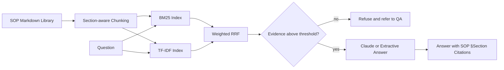

# Pharma SOP Copilot

   [](https://github.com/raj75114043-design/ai-ml-portfolio/actions/workflows/ci.yml) [](https://raj-pharma-sop-copilot.streamlit.app) [](https://github.com/users/raj75114043-design/packages/container/package/ai-ml-portfolio%2Fpharma-sop-copilot)

A retrieval-augmented assistant that answers questions about pharmaceutical quality SOPs —
OOS, OOT, deviations, CAPA, change control and data integrity — with a **citation to the exact SOP
section for every answer** and a **guardrail that refuses questions the SOP library does not cover**.

## Business Problem

Quality and laboratory staff spend significant time searching long SOPs for timelines and rules
during investigations. Generic chatbots can produce confident but unsupported answers, which is
unacceptable in a GxP environment. This copilot answers only from approved SOP text and always shows
its source.

## Architecture



## Key Design Decisions

| Decision | Reason |
|---|---|
| Chunk by SOP section heading | Citations point to a precise, auditable location |
| Hybrid retrieval | Exact terms (Phase Ib, ALCOA+) and paraphrased questions both work |
| Evidence threshold guardrail | Unsupported questions are refused rather than answered |
| Mandatory citations | Every statement is traceable to approved text |
| LLM optional | Runs fully offline with extractive answers; uses Claude when `ANTHROPIC_API_KEY` is set |

## Results

Output of the reproducible run (`python main.py`):

```
Indexed 33 SOP sections from 6 SOPs
Retrieval: Hit@3 = 1.00, Hit@1 = 1.00 on 8 questions

Q: How long do we have to complete a Phase Ib OOS investigation?
A: Phase Ib must be completed within five working days. [SOP-QA-001 §5] If no laboratory root cause is identified, the investigation is escalated to a full-scale Phase II investigation involving Production, Quality Assurance and Engineering. [SOP-QA-001 §6]

Q: What is the capital of France?
A: I could not find this in the approved SOP library. Please consult Quality Assurance rather than relying on an unsupported answer.
```

## Project Structure

```
data/sops/          Six synthetic quality SOPs (Markdown)
data/eval_set.json  Labelled questions for retrieval evaluation
src/ingest.py       Section-aware chunking
src/retrieval.py    BM25 + TF-IDF hybrid retriever with RRF
src/copilot.py      Answering, citations and guardrail
app.py              Streamlit chat interface
tests/              Automated tests
```

## Run, Deploy and Test

**Web application**

```bash
cd pharma-sop-copilot
pip install -r requirements.txt
streamlit run app.py
```

Live demo: https://raj-pharma-sop-copilot.streamlit.app

**Docker**

```bash
docker build -t pharma-sop-copilot .
docker run -p 8501:8501 pharma-sop-copilot
# or pull the published image
docker pull ghcr.io/raj75114043-design/ai-ml-portfolio/pharma-sop-copilot:latest
```

**Tests**

```bash
pytest -q
```

Every push to the [`ai-ml-portfolio`](https://github.com/raj75114043-design/ai-ml-portfolio) repository runs this project's tests through GitHub Actions and publishes its Docker image to GitHub Container Registry.

> The SOPs in this repository are synthetic, simplified and illustrative. They are not regulatory guidance.
