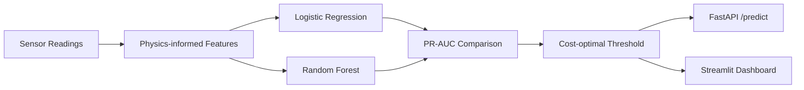

# Predictive Maintenance — Failure Classifier

   [](https://github.com/raj75114043-design/ai-ml-portfolio/actions/workflows/ci.yml) [](https://raj-predictive-maintenance-classifier.streamlit.app) [](https://github.com/users/raj75114043-design/packages/container/package/ai-ml-portfolio%2Fpredictive-maintenance-classifier)

Predicts machine failure from sensor readings on a heavily **imbalanced** dataset, compares models on
**PR-AUC**, and selects the decision threshold that **minimises business cost** rather than using 0.5.
Served through a validated **FastAPI** endpoint and an interactive **Streamlit** dashboard.

## Business Problem

An unplanned breakdown costs far more than an unnecessary inspection. With failures in only a few
percent of readings, accuracy is misleading — a model that predicts "no failure" every time looks
excellent and catches nothing. The objective is to catch failures at an acceptable inspection cost.

## Approach

| Step | Implementation |
|---|---|
| Data | 10,000 synthetic readings: temperatures, speed, torque, tool wear, vibration |
| Features | Mechanical power, heat-dissipation margin, wear × torque |
| Imbalance | Stratified split, class weighting, PR-AUC as the primary metric |
| Models | Logistic Regression (scaled) vs Random Forest |
| Threshold | Grid search minimising expected cost (missed failure 5,000 vs false alarm 400) |
| Serving | FastAPI `/predict` with range validation; Streamlit dashboard |



## Results

Output of the reproducible run (`python -m src.train`):

```
Failure rate: 3.2%. Selected model: Random Forest
                     pr_auc  roc_auc  threshold  missed_failures  false_alarms  expected_cost
Logistic Regression   0.384    0.909       0.69             18.0         203.0       171200.0
Random Forest         0.501    0.932       0.15             14.0         163.0       135200.0
```

## API

```bash
uvicorn src.api:app --reload
curl -X POST localhost:8000/predict -H "Content-Type: application/json" \
  -d '{"air_temp_k":302,"process_temp_k":310.5,"rotational_speed_rpm":1300,"torque_nm":62,"tool_wear_min":230,"vibration_mm_s":5}'
```

## Run, Deploy and Test

**Web application**

```bash
cd predictive-maintenance-classifier
pip install -r requirements.txt
streamlit run app.py
```

Live demo: https://raj-predictive-maintenance-classifier.streamlit.app

**Docker**

```bash
docker build -t predictive-maintenance-classifier .
docker run -p 8501:8501 predictive-maintenance-classifier
# or pull the published image
docker pull ghcr.io/raj75114043-design/ai-ml-portfolio/predictive-maintenance-classifier:latest
```

**Tests**

```bash
pytest -q
```

Every push to the [`ai-ml-portfolio`](https://github.com/raj75114043-design/ai-ml-portfolio) repository runs this project's tests through GitHub Actions and publishes its Docker image to GitHub Container Registry.

> All sensor data in this repository is synthetic.
