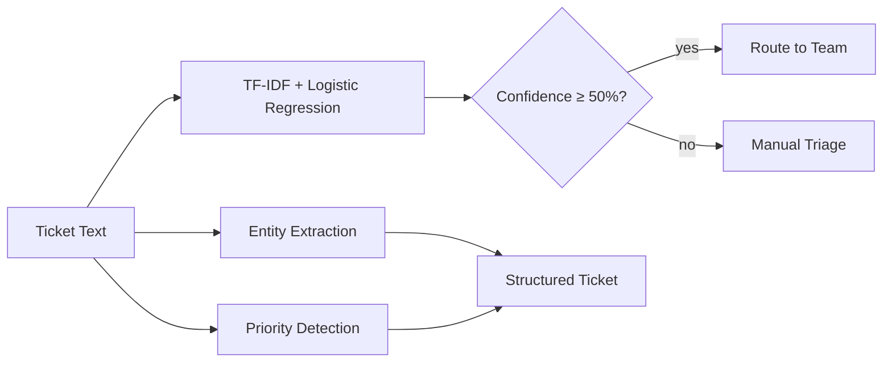

# Support Ticket Triage — NLP

   [](https://github.com/raj75114043-design/ai-ml-portfolio/actions/workflows/ci.yml) [](https://raj-support-ticket-nlp.streamlit.app) [](https://github.com/users/raj75114043-design/packages/container/package/ai-ml-portfolio%2Fsupport-ticket-nlp)

Automatic triage of IT support tickets: **category classification**, **entity extraction** (ticket IDs,
error codes, invoices, IPs, emails, products), **priority detection** and **routing to the right team**,
with a confidence threshold that sends uncertain tickets to manual triage.

## Business Problem

Service desks lose hours each day reading and re-routing tickets. Mis-routed tickets breach SLAs, and
key identifiers buried in free text must be copied by hand into downstream systems.

## Approach

| Component | Implementation |
|---|---|
| Classifier | Word (1–2) + character (3–5) TF-IDF features with class-balanced logistic regression |
| Evaluation | Stratified hold-out, macro-F1 and per-class precision/recall |
| Entity extraction | Precise regular expressions and a product gazetteer for IDs that must be exact |
| Priority | Urgency-phrase detection (P1 / P3) |
| Routing | Category → team mapping; confidence below 50% goes to manual triage |
| Data | 1,500 synthetic tickets across five categories with ~6% deliberate label noise |



## Results

Output of the reproducible run (`python main.py`):

```
Trained on 1200 tickets; macro-F1 on 300 held-out tickets = 0.937
              precision  recall  f1-score
Access            0.933   0.918     0.926
Billing           0.934   0.950     0.942
Hardware          0.889   0.949     0.918
Network           0.982   0.918     0.949
Software          0.949   0.949     0.949
macro avg         0.938   0.937     0.937
weighted avg      0.938   0.937     0.937

Example: Urgent: Outlook crashes with error E512 on startup. Ticket INC204211, contact me at priya@example.com
 -> Software (86%) | Application Support | P1 - High
 -> entities: PRODUCT=Outlook, ERROR_CODE=E512, TICKET_ID=INC204211, EMAIL=priya@example.com
```

## Run, Deploy and Test

**Web application**

```bash
cd support-ticket-nlp
pip install -r requirements.txt
streamlit run app.py
```

Live demo: https://raj-support-ticket-nlp.streamlit.app

**Docker**

```bash
docker build -t support-ticket-nlp .
docker run -p 8501:8501 support-ticket-nlp
# or pull the published image
docker pull ghcr.io/raj75114043-design/ai-ml-portfolio/support-ticket-nlp:latest
```

**Tests**

```bash
pytest -q
```

Every push to the [`ai-ml-portfolio`](https://github.com/raj75114043-design/ai-ml-portfolio) repository runs this project's tests through GitHub Actions and publishes its Docker image to GitHub Container Registry.

> All tickets in this repository are synthetic.
